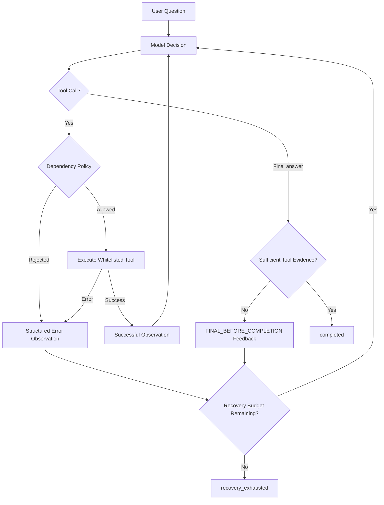

# Level 2 — Error Recovery & Retry

**Goal:** Build a ReAct loop that recovers from *bad decisions* and *tool execution failures* instead of treating every violation as a terminal failure.

**Prerequisites:** [Level 0](../0-agent-loop-react/README.md) (Agent Loop) and [Level 1](../1-multi-step-tool-calling/README.md) (Multi-Step Tool Calling).

This lesson is **standalone**: it owns its runtime, model adapter, tool handlers and unit tests. It does not import either previous lesson. It uses the one `requirements.txt` and one `.env` at the workspace root.

## 1. What changes from Lab 1?

Lab 1 uses a strict `required_order` tuple. When the model violates it, the runtime returns `policy_violation` and stops.

Lab 2 has **three separate responsibilities**:

| Component | Purpose | Does it execute the tool? |
| --- | --- | --- |
| `AgentRunner` | Loop, message history, trace, call correlation, budgets | Delegates |
| `DependencyPolicy` | Decide whether prerequisites and source data are satisfied | No |
| `ToolRegistry` | Decode arguments, apply policy and run whitelisted handler | Yes |
| `RecoveryPolicy` | Upper bounds for model calls, tool attempts and rejected/error turns | No |
| `Model` | Propose the next tool or a final answer based on observations | No |

The runtime is **not hardcoded to iteration 1 = get_customer, iteration 2 = get_orders**. Instead:

- `get_orders` needs a **successful** `get_customer` observation.
- The customer name given to `get_orders` must match the resolved customer.
- `sum_amounts` needs a **successful** `get_orders` observation.
- The amounts passed to `sum_amounts` must match the amounts returned by `get_orders`.
- A final answer is only accepted after `sum_amounts` succeeds, or after the customer lookup successfully establishes that the customer does not exist.

For this particular task, those dependencies naturally imply a valid successful order. **The model is free to make mistakes; the runtime refuses unsafe or ill-grounded actions and supplies feedback.**

## 2. ReAct recovery lifecycle



Each rejected **tool call** is still sent back to the model as an ordinary `role="tool"` result tied to the original `tool_call_id`. This is essential for OpenAI-compatible message history. A rejected **final answer** has no tool call ID, so this teaching implementation sends a separate runtime feedback message.

### Example: Wrong tool order

```text
Request: Calculate paid order revenue for customer_id=1.

Model 1: get_orders(customer="Lan", status="paid")
Runtime: {"ok": false, "tool": "get_orders",
          "error": {"code": "PREREQUISITE_MISSING",
                    "message": "Call get_customer successfully before get_orders."}}

Model 2: get_customer(customer_id=1)
Runtime: {"ok": true, "tool": "get_customer", "data": {"found": true, ...}}

Model 3: get_orders(customer="Lan", status="paid")
Runtime: {"ok": true, "tool": "get_orders", "data": {"orders": [...]}}

Model 4: sum_amounts(amounts=[120000, 80000])
Runtime: {"ok": true, "tool": "sum_amounts", "data": {"total": 200000}}

Model 5: "Paid revenue for Lan: 200,000 VND"
Status: completed; errors: 1; tool attempts: 4; model calls: 5.
```

The failure is part of the **trajectory**, not silently swallowed.

Some OpenAI-compatible models produce an empty response after their final tool result. This lab records `EMPTY_MODEL_TURN`, feeds the model a continuation instruction, and stops if the error budget is exhausted. It does not use hidden reasoning content as the final answer.

## 3. Error taxonomy and behavior

| Code / event | Cause | Model-visible feedback? | Default outcome |
| --- | --- | --- | --- |
| `PREREQUISITE_MISSING` | Tool requires another successful observation | Yes | Correct next action |
| `DATA_MISMATCH` | Customer/amounts disagree with observed source data | Yes | Correct arguments |
| `CUSTOMER_NOT_FOUND` | Trying to read orders for a nonexistent customer | Yes | Stop with factual not-found answer |
| `INVALID_ARGUMENTS` | Malformed JSON or invalid handler arguments | Yes | Fix JSON / parameters |
| `UNKNOWN_TOOL` | Tool name not present in allowlist | Yes | Choose allowed tool |
| `TOOL_EXECUTION_FAILED` | Handler raised an unexpected exception | Yes | Model may retry / change plan |
| `MULTIPLE_TOOL_CALLS_UNSUPPORTED` | Model batched tool calls; lab requires one per turn | Yes, one result per call ID | Retry one at a time |
| `FINAL_BEFORE_COMPLETION` | Model finished without required tool evidence | Yes, via feedback message | Continue reasoning/actions |
| `EMPTY_MODEL_TURN` | Model returned neither tool calls nor final content | Yes, via feedback message | Ask model to continue with a tool or non-empty answer |
| `protocol_error` | Empty response, missing/reused tool call ID | No | Stop (protocol invalid) |
| `provider_error` | LLM provider call failed | No | Stop (outside lesson's retry policy) |
| `recovery_exhausted` | Error count has reached the configured maximum | No | Stop |
| `budget_exceeded` | Max model calls or tool attempts reached | No | Stop |

**Important distinction:** An *LLM-driven retry* means the runtime reports a tool failure to the model, then the **model chooses** whether to reissue the tool. It is not an invisible automatic retry inside `ToolExecutor`. Provider/network retries are a separate responsibility, intentionally not implemented here.

The handler exception is intentionally not forwarded verbatim to the LLM, to avoid leaking local diagnostic or secret content.

## 4. Run Lab 2

All lessons use the same root virtual environment and the same root `.env`.

### Understand run modes

The most useful error-recovery experiment is **LLM Response Fault Injection**:

```text
User + System Prompt → Real LLM response → ResponseFaultInjector
                                              ↓
                                  Replace only FIRST decision
                                              ↓
                            Runtime validates the injected action
                                              ↓
                           Structured error → REAL LLM follow-up
                                              ↓
                              Correct action → Final answer
```

The real provider is called on the first turn, but its normalized response is discarded and replaced. **Only the first decision is synthetic.** Every later decision comes from the real model using the structured error observation. This tests the recovery path without relying on the model spontaneously making a mistake despite a good system prompt. An injected wrong order tests decision recovery; it does not demonstrate that the underlying LLM naturally makes that mistake.

- `--scenario <name>` **always selects the deterministic mock model**, even when `LIVE_MODE=1` was previously exported in your shell. This is the correct way to **guarantee a controlled error** for the lab.
- `--live` explicitly selects the real LLM and uses the shared root `.env`.
- Without either flag, the program keeps compatibility with `LIVE_MODE=1`; otherwise it runs the default offline `wrong-order` scenario.
- `--live --inject-tool-failure` uses the **real LLM** but injects exactly one simulated transient `get_orders` execution failure. The model must decide whether to retry after reading the error observation.
- `--live --inject-llm-response wrong-order` replaces the **first real LLM decision** with `get_orders` before customer lookup, causing `PREREQUISITE_MISSING`. Other choices: `invalid-arguments` and `early-final`. All later LLM calls remain real. Choose **only one** injection type per run.

The CLI prints `Mode: mock (...)` or `Mode: live (...)` at startup so you can confirm which model is running. A successful live run with zero errors is expected if the LLM follows its system prompt and the tools do not fail.


```bash
cd ~/lab/ai-agent-learning
python3 -m venv .venv            # only if you do not have one yet
source .venv/bin/activate
python -m pip install -r requirements.txt

# Offline: intentionally misordered first action
python 2-error-recovery/agent.py --scenario wrong-order

# Offline: intentionally malformed tool arguments
python 2-error-recovery/agent.py --scenario invalid-arguments

# Offline: first get_orders call raises a transient error
python 2-error-recovery/agent.py --scenario tool-failure

# Offline: final answer is attempted too early
python 2-error-recovery/agent.py --scenario early-final

# Offline: baseline, valid execution
python 2-error-recovery/agent.py --scenario normal

# Different input must produce a different result
python 2-error-recovery/agent.py --scenario normal --question "Calculate paid order revenue for customer_id=2."
```

Expected paid revenue:

- customer_id=1 → **200,000 VND** (Lan)
- customer_id=2 → **45,000 VND** (Minh)
- customer_id=999 → "Customer 999 was not found"

To run with a live OpenAI API or OpenAI-compatible vLLM endpoint, configure **only** the root `.env` (do not create a lesson-local `.env`):

```dotenv
LLM_BASE_URL=https://api.openai.com/v1
LLM_MODEL=your-tool-capable-model
LLM_API_KEY=your-secret-api-key
LLM_TIMEOUT=30
```

For local vLLM, change `LLM_BASE_URL` to e.g. `http://localhost:8000/v1` and choose a supported tool-calling model. The placeholder key `EMPTY` is used only if no key is set; hosted OpenAI requires a valid key.

```bash
cd ~/lab/ai-agent-learning
LIVE_MODE=1 .venv/bin/python 2-error-recovery/agent.py \
  --question "Calculate paid order revenue for customer_id=1."

# Or select real model explicitly, independent of the exported flag:
.venv/bin/python 2-error-recovery/agent.py --live \
  --question "Calculate paid order revenue for customer_id=1."

# Deterministically test a transient tool failure with the real LLM:
.venv/bin/python 2-error-recovery/agent.py --live --inject-tool-failure \
  --question "Calculate paid order revenue for customer_id=1."

# MOST USEFUL: replace first real LLM response with a wrong tool call:
.venv/bin/python 2-error-recovery/agent.py --live --inject-llm-response wrong-order \
  --question "Calculate paid order revenue for customer_id=1."

# Replace first response with invalid tool arguments:
.venv/bin/python 2-error-recovery/agent.py --live --inject-llm-response invalid-arguments

# Replace first response with a premature final answer:
.venv/bin/python 2-error-recovery/agent.py --live --inject-llm-response early-final

# This is always mock, even if you exported LIVE_MODE=1:
.venv/bin/python 2-error-recovery/agent.py --scenario wrong-order
```

Live mode uses `tool_choice="auto"` and the runtime's feedback loop. The system prompt tells the model the expected dependencies, so it is normal for an unmodified live run to produce **zero errors**. An injected execution failure validates recovery from tool errors, while LLM response injection validates recovery from a wrong model decision, without replacing the model on later turns. Pure mock scenarios validate deterministic behavior without provider calls. Actual model behavior may vary by provider and model. These unit tests do not guarantee any provider will recover successfully. Live calls can incur cost.

## 5. Read the code in this order

1. **`ToolCall` / `ModelTurn`**: data returned by the LLM; the LLM does not directly execute tools.
2. **`ToolRegistry.execute()`**: whitelisted execution, JSON parsing, policy check, handler errors, structured observations.
3. **`DependencyPolicy`**: validates *data dependencies*, not arbitrary fixed iteration indices.
4. **`RecoveryPolicy`**: budget envelope: 10 model calls, 10 tool attempts, 3 recoverable errors by default.
5. **`AgentRunner.run()`**: state updates, tracing of failed and successful actions, feedback, termination.
6. **`MockModel`**: offline scripted behavior derived from conversation tool observations, including intentionally wrong first action.
7. **`openai_compatible_model()`**: real model adapter using the **shared root** environment.
8. **`ResponseFaultInjector`**: delegates to the real provider, replaces only the first normalized `ModelTurn`, then forwards all later responses unchanged.

## 6. Tests

```bash
cd ~/lab/ai-agent-learning
.venv/bin/python -m unittest discover -s 2-error-recovery/tests -v
```

Tests cover normal behavior, wrong order recovery, invalid JSON/type recovery, tool exception/retry, early-final rejection, empty-model-turn recovery, foreign customer data, incorrect amount provenance, unknown tools, duplicate call IDs, multi-tool batches, not-found completion, model/tool/error budgets and provider failures. All tests are offline and deterministic.

## 7. Guided exercises

**Exercise A — Feedback-based repair:** Run `--scenario wrong-order`. Explain why the rejected action never executed the underlying handler but is still visible in history. Locate the `tool_call_id` mapping.

**Exercise B — Argument repair:** Run `--scenario invalid-arguments`. Explain the difference between a tool schema advertised to the model and *actual validation performed by the handler*.

**Exercise C — Transient failure:** Run `--scenario tool-failure`. Confirm that the model, not the runtime, chooses to retry `get_orders`.

**Exercise D — Exhaustion:** In a unit test, create a model that repeatedly requests `get_orders` without `get_customer`. Why must the runtime stop?

**Exercise E — Dependency policy:** Change a scripted model to request `sum_amounts(amounts=[9])` after reading orders. Confirm the action is refused with `DATA_MISMATCH`.

**Exercise F — Evaluate trajectories:** Compare 4 model calls and 0 errors (normal) against 5 model calls and 1 error (recovering run). Both answers match; execution quality differs.

## 8. Deliberate limits and next steps

This is an educational runtime, not a production agent executor:

- No durable checkpointing, async execution, cancellation, per-tool timeout or resource sandbox.
- Registry does not use a general-purpose JSON Schema validator; handlers validate their arguments.
- Retry errors are counted globally. No backoff, circuit breaker, repeated-action detector, or provider retry policy.
- Provider failure is terminal. Error feedback is simplified into user/tool messages for portability.
- "completed" means that sufficient **tool execution evidence** exists and the model returned a final answer. It does **not** independently verify the final numeric statement.
- The successful-action dictionary uses tool names as keys; this is a teaching shortcut for a single customer workflow, not a general-purpose multi-entity state model.
- All example tools are read-only and deterministic except the intentionally failing simulation.

**Suggested next lesson:** `3-agent-state-management` — explicit state transitions, structured events, iteration snapshots and reusable recovery context.

**Further reading:** [ReAct paper](https://arxiv.org/abs/2210.03629) · [OpenAI function calling guide](https://platform.openai.com/docs/guides/function-calling).