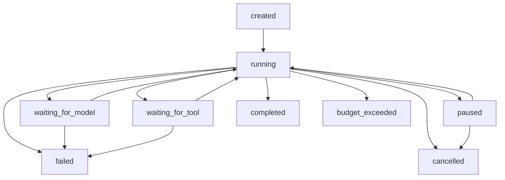

# Level 3 — Agent State Management & Execution Lifecycle

**Goal:** Learn to represent an agent run as explicit state, record each transition as an event, save a JSON checkpoint, pause after a safe tool boundary, and **resume from a fresh process without executing previously completed tools again**.

**Prerequisites:** [Lab 0](../0-agent-loop-react/README.md) (ReAct), [Lab 1](../1-multi-step-tool-calling/README.md) (tool correlation), and [Lab 2](../2-error-recovery/README.md) (feedback-based recovery).

This lab is **independent**: all imports are within `3-agent-state-management`. It uses the one workspace-level `.env` and `requirements.txt`. No new dependency is required.

## 1. What is Agent State?

A model request is not an agent run. The model responds with a proposed action. The **runtime** must preserve the authoritative progress, including whether a tool executed and what it returned.

```text
AgentState
  run_id          Stable identifier across pause/resume
  request         Original user request
  status          Explicit execution lifecycle
  messages        Complete model/tool conversation needed for next decision
  successful      Observations from successfully completed tools
  events          Ordered append-only trace (seq, kind, details)
  used_call_ids   IDs already committed to message history
  model_calls     Cumulative model call budget
  tool_attempts   Cumulative tool execution budget
  errors          Cumulative tool error count
  answer          Final model answer, if completed
  failure_reason  Reason for stopping, if terminal
```

The **LLM is not the state owner**. The runtime is. This matters when an LLM provider changes, the program restarts, or the user requests cancellation.

### Three related but different structures

| Structure | What it answers | Example |
| --- | --- | --- |
| `messages` | What context does the model need next? | Assistant tool call, matching tool response |
| `successful` | Which completed tool observations support future actions? | `get_customer` returned Lan |
| `events` | What happened, in what order, and why? | `waiting_for_tool → running`, `tool_result` |

They are **not interchangeable**. Event logs assist debugging; messages preserve conversational protocol; structured state supports policy decisions.

## 2. Explicit state machine



The actual transition contract is in `state.py:ALLOWED`. Illegal transitions raise `ValueError`, e.g. `created → completed` or `completed → running`.

**Terminal states:** `completed`, `failed`, `budget_exceeded`, `cancelled`. In this lab, terminal states cannot be resumed.

**Transient states:** `waiting_for_model` and `waiting_for_tool` describe runtime progress. They are shown in events, but checkpoints are **not saved in the middle of those activities**.

## 3. State transitions and event sourcing basics

Read `AgentState.transition()` in `state.py`:

```python
def transition(self, target: Status, *, reason: str = "") -> None:
    if target not in ALLOWED[self.status]:
        raise ValueError(f"Invalid transition: {self.status.value} -> {target.value}")
    previous = self.status
    self.status = target
    self.emit("state_changed", previous=previous.value, current=target.value, reason=reason)
```

`AgentState.emit()` assigns an increasing sequence number:

```python
def emit(self, kind: str, **data: Any) -> None:
    self.events.append({"seq": len(self.events) + 1, "kind": kind, **data})
```

The event sequence is preserved after resumption. A full event log can explain the path of a run. Here it is **events plus a snapshot**, not full production event-sourcing architecture: state is not replayed exclusively from immutable events.

## 4. How checkpoint/resume works

**A checkpoint is a serialized state snapshot**, not a copy of a Python process. JSON contains the model conversation, progress counters, validated tool observations and event history. It does **not** store the SDK client or API credentials.

When one tool call settles:

1. The registry returns a tool observation.
2. The runtime appends the matching `role="tool"` response to `messages`.
3. It records `tool_result`, updates `successful`, counters and `used_call_ids`.
4. It transitions back to `running` and saves the checkpoint (optional).
5. If the requested pause threshold was reached, it transitions to `paused` and saves that state.

At resume time, `CheckpointStore.load()` reconstructs `AgentState`. A new `AgentRunner` and even a new `MockModel`/OpenAI SDK client use the restored **messages** to continue from the next model decision.

The store writes to a temporary JSON file, flushes and atomically replaces the target checkpoint with `os.replace()`, avoiding a partially written file on normal local filesystems. New checkpoint files are created with mode `0600` on POSIX.

**Important limit:** If the process crashes *during* an external tool action, the runtime cannot prove whether the side effect occurred before the next checkpoint. This lab demonstrates resume from settled boundaries, **not exactly-once execution**. Production systems need idempotency keys, durable queues and transactional design for side-effectful tools. Do not rely on these checkpoints for untrusted or sensitive production data.

## 5. Practice A — Normal run

From the workspace root:

```bash
cd ~/lab/ai-agent-learning
source .venv/bin/activate

python 3-agent-state-management/agent.py --mock \
  --question "Calculate paid order revenue for customer_id=1."
```

Expected:

```text
created → running
running → waiting_for_model → running
running → waiting_for_tool → running   # get_customer
running → waiting_for_model → running
running → waiting_for_tool → running   # get_orders
running → waiting_for_model → running
running → waiting_for_tool → running   # sum_amounts
running → waiting_for_model → running
running → completed

Status: completed
Model calls: 4, Tool attempts: 3
Answer: Paid revenue for Lan: 200,000 VND
```

No checkpoint file is written unless `--checkpoint` is supplied.

## 6. Practice B — Pause, close Python, resume

The two commands below execute in **separate Python processes**:

```bash
# Step 1: save state after the first successful tool call
python 3-agent-state-management/agent.py --mock \
  --checkpoint 3-agent-state-management/checkpoints/practice.json \
  --pause-after-tools 1

# Step 2: resume from the checkpoint
python 3-agent-state-management/agent.py --mock \
  --checkpoint 3-agent-state-management/checkpoints/practice.json \
  --resume
```

After the first run:

```text
get_customer → OK
Status: paused
Model calls: 1, Tool attempts: 1
```

After `--resume`:

```text
paused → running
get_orders → OK
sum_amounts → OK
Status: completed
Model calls: 4, Tool attempts: 3
```

The tool `get_customer` is *not executed again*. Its earlier observation is still in the restored model conversation and `successful` state. The CLI may print the entire accumulated event history, so an earlier `get_customer` event can still appear in the resume output; that **does not mean it was re-executed**.

Inspect the saved JSON in VS Code (`checkpoints/` is gitignored). Do not manually edit and reuse it as an execution source unless you understand the integrity risks.

**Fresh run:** use a different checkpoint filename; the CLI intentionally refuses to overwrite an existing checkpoint without `--resume`.

## 7. Practice C — Pause multiple times and cancel

```bash
# Pause after the first tool
python 3-agent-state-management/agent.py --mock \
  --checkpoint 3-agent-state-management/checkpoints/cancel-demo.json \
  --pause-after-tools 1

# Cancel the saved run (no LLM call)
python 3-agent-state-management/agent.py \
  --checkpoint 3-agent-state-management/checkpoints/cancel-demo.json \
  --cancel

# This will correctly refuse to resume a cancelled run
python 3-agent-state-management/agent.py --mock \
  --checkpoint 3-agent-state-management/checkpoints/cancel-demo.json \
  --resume
```

The cancel operation is terminal. It is **not equivalent to deleting a checkpoint**. The persisted status becomes `cancelled`; its trace remains available.

## 8. Practice D — Live model via the one shared root .env

The CLI follows `LIVE_MODE=1` if you exported it; `--mock` always overrides that setting. Use `--live` to explicitly choose OpenAI API or an OpenAI-compatible vLLM endpoint.

```bash
cd ~/lab/ai-agent-learning
python 3-agent-state-management/agent.py --live \
  --checkpoint 3-agent-state-management/checkpoints/live-practice.json \
  --pause-after-tools 1

# This can run after the first process has exited:
python 3-agent-state-management/agent.py --live \
  --checkpoint 3-agent-state-management/checkpoints/live-practice.json \
  --resume
```

A live model must support Chat Completions structured tool calls. You may get a different trajectory than the deterministic mock. Live calls may incur usage charges. Check the results before treating the response as correct.

## 9. Unit tests

```bash
cd ~/lab/ai-agent-learning
.venv/bin/python -m unittest discover -s 3-agent-state-management/tests -v
```

The tests cover transitions, event ordering, JSON round-trip, resume across new model instances, no duplicate tool execution, repeated pause/resume, cancellation, corrupted checkpoints, cumulative budgets and completion semantics.

## 10. Implementation map

| File | Responsibility |
| --- | --- |
| `state.py` | `Status`, `AgentState`, valid transitions, sequenced events, atomic JSON `CheckpointStore` |
| `agent.py` | `AgentRunner`, `ToolRegistry`, model contracts, mock/live adapters, CLI |
| `tests/test_agent.py` | Lifecycle, persistence, budget and resume contract tests |

Read `AgentState.new()`, `AgentState.transition()`, `CheckpointStore.save()/load()`, and then `AgentRunner.execute()` in that order.

## 11. Exercises

**Exercise 1 — State diagram:** Explain why `waiting_for_tool → completed` is forbidden and why `completed → running` is forbidden.

**Exercise 2 — Event audit:** Pause after two tool calls and inspect `events`. Identify the event that records `tool_call_id` and the corresponding tool response in `messages`.

**Exercise 3 — Resume invariant:** Resume a paused run using a newly constructed `MockModel`. Prove that counters and `run_id` are unchanged except for new actions.

**Exercise 4 — Cancellation:** Explain why cancellation does not remove the checkpoint and why cancelled runs cannot resume.

**Exercise 5 — Crash window:** Imagine `get_orders` performs a payment instead of a read-only lookup. Which failure modes could cause duplicate payments if a process crashes between execution and checkpoint persistence? Suggest an idempotency-key design.

**Exercise 6 — Result verification:** A model executes all three tools but answers `300,000 VND`. Why would this run still have `completed` status? Design a separate result verifier (for a future lab).

## 12. Design tradeoffs & limits

- **In-memory only:** simplest but cannot resume after restarting Python.
- **JSON snapshot (this lab):** easy to inspect and enough for single-run tutorials; no concurrency control, no distributed locking, no transactional tool semantics.
- **Event-only replay:** rich audit/replay, but requires a reliable event store, deterministic reducers and schema/version migration.
- **Database-backed checkpoints:** support durable multi-run management, locking/leases and operational monitoring at higher complexity.

This implementation intentionally stays single-process, synchronous and read-only at the tool layer. It does not provide provider retry/backoff, async cancellation, parallel tool calls, schema migration, encryption or trustworthy production checkpoint recovery. Checkpoints include **conversation text**, so protect them as potentially sensitive data; never commit them.

**Suggested next lab:** `4-planning-replanning` — planning, feedback, replanning decisions and plan validation.
