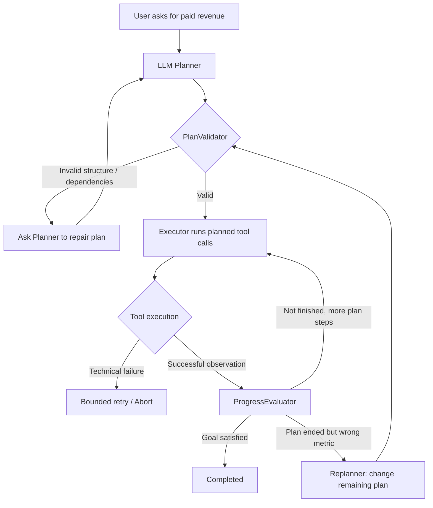

# Level 4 — Planning, Goal Evaluation & Strategic Replanning

**Learning objective:** Understand why **a structurally valid plan and successful tool calls can still fail the user's actual goal**, and how an agent detects this semantic mismatch, preserves useful evidence, and changes its remaining plan.

This lab is **standalone**, implemented in Python, and does not import Labs 0–3. It uses only the shared workspace-root `.env` and `requirements.txt` for live OpenAI/OpenAI-compatible LLM calls. Source, tests, and documentation are in English.

**Prerequisites:** Lab 0 (Agent Loop), Lab 1 (Tool Dependencies), Lab 2 (Error Recovery), Lab 3 (Agent State & Execution Trace).

## 1. The main problem: success is not goal satisfaction

User question:

> Calculate **paid order revenue** for `customer_id=1`.

Consider two plausible plans:

| | Structurally valid? | Tools work? | Achieves user goal? |
| --- | --- | --- | --- |
| A: `get_customer → get_orders → sum_amounts` | Yes | Yes | **Yes** — returns money (200,000 VND) |
| B: `get_customer → get_orders → count_orders` | Yes | Yes | **No** — returns a count (2 orders) |

Plan B has the right dependencies and legitimate, allowlisted tools. Its `count_orders` execution succeeds — it calculates the number of paid orders correctly. **But the user asked for monetary revenue, not the number of orders.**

This is a **semantic planning error**, not a JSON format error, wrong argument, database failure, or tool exception. This is the central use case for Replanning in this lesson.

### The distinction

- **PlanValidator:** Is the plan structurally sound and executable using allowed tools and satisfied prerequisites?
- **Executor / ToolRegistry:** Did each tool call follow the contract, use grounded arguments, and return a successful observation?
- **ProgressEvaluator:** Does the accumulated evidence actually satisfy the *user's goal*?
- **Replanner:** If the plan was executable but failed the goal, what **different remaining work** is required?



In this lesson `ProgressEvaluator` performs **deterministic checks**, not another LLM call. This keeps the expected goal measurable and makes the exercise reproducible.

## 2. File structure

```text
4-planning-replanning/
├── README.md
├── planning.py          # Plan, PlanStep, PlanValidator
├── evaluation.py        # ProgressEvaluator, GoalEvaluation
├── agent.py             # AgentRunner, state, tools, mock/live models, injections
└── tests/
    └── test_agent.py
```

The components have clear responsibilities:

| Component | Responsibility |
| --- | --- |
| `PlanningModel.propose_plan(context)` | LLM proposes the **next plan revision** |
| `PlanValidator.parse/validate` | Validates JSON structure, allowlisted tools, dependency order, step IDs, duplicated work and plan termination |
| `PlanningModel.propose_action(context, tools)` | LLM proposes one tool call for the current planned step |
| `ToolRegistry.execute` | Checks input and provenance, then runs the chosen handler |
| `ProgressEvaluator.evaluate(evidence)` | Evaluates goal satisfaction using actual successful tool results |
| `AgentRunner.run` | Controls the lifecycle, plan revisions, evidence, retry limits, goal checks and termination |
| `RunState` | Records `evidence`, `events`, `plan_history` and budgets |
| `PlanFaultInjector` | Replaces **one** real LLM plan response with a valid-but-wrong plan for a repeatable live experiment |

The runtime is authoritative; the LLM may propose actions or revisions but cannot bypass validation.

## 3. Tool contracts and dependency rules

The demo contains these four allowlisted tools:

| Tool | Inputs | Output | Meaning |
| --- | --- | --- | --- |
| `get_customer` | `customer_id` | Customer record | Resolve identity |
| `get_orders` | `customer`, `status="paid"` | Paid orders | Gather financial evidence |
| `count_orders` | `order_ids` | `{"count": 2}` | **Number** of orders, NOT revenue |
| `sum_amounts` | `amounts` | `{"total": 200000}` | **Monetary total**, satisfies revenue goal |

Dependency rules in `agent.py`:

```python
RULES = {
    "get_customer": (),
    "get_orders": ("get_customer",),
    "sum_amounts": ("get_orders",),
    "count_orders": ("get_orders",),
}
```

The `PlanValidator` is configured with two allowable **structural terminal tools**: `sum_amounts` and `count_orders`. That does **not** mean both satisfy the user's revenue goal. It means a plan ending in either one can be structurally executable, leaving the final objective assessment to `ProgressEvaluator`.

Tool arguments remain grounded in prior results: `get_orders.customer` must match the resolved customer, `count_orders.order_ids` must match returned order IDs, and `sum_amounts.amounts` must match returned paid order amounts. The runtime refuses inconsistent tool inputs.

## 4. Primary exercise — A plan that is executable but logically wrong

**Run this first.** `--scenario` forces deterministic mock mode even if `LIVE_MODE=1` is exported:

```bash
cd ~/lab/ai-agent-learning
.venv/bin/python 4-planning-replanning/agent.py --scenario semantic-mismatch
```

Expected console trace from the local mock scenario:

```text
Mode: mock | scenario=semantic-mismatch

Plan revision 1 : get_customer -> get_orders -> count_orders
Step completed: get_customer
Step completed: get_orders
Step completed: count_orders

Goal mismatch: GOAL_METRIC_MISMATCH -
count_orders returns the number of paid orders, not their revenue.
Use sum_amounts with amounts from get_orders.

Replan triggered: GOAL_METRIC_MISMATCH
Plan revision 2 : sum_amounts
Step completed: sum_amounts

Status: completed
Model calls: 6; plan attempts: 2; tool attempts: 4; errors: 0
Answer: Paid revenue for Lan: 200,000 VND
```

### Trace the decision, one stage at a time

**Stage A — Planner creates the wrong plan.** It produces a valid JSON plan for `get_customer → get_orders → count_orders`. All step IDs, tools and dependency declarations are valid, so `PlanValidator` accepts it. There is **no tool exception**.

**Stage B — Executor follows the plan.** It calls `get_customer`, then `get_orders`, then `count_orders`. All three return `ok=true`. At this point `state.evidence` contains:

```json
{
  "get_customer": {
    "found": true,
    "customer": {"id": 1, "name": "Lan"}
  },
  "get_orders": {
    "orders": [
      {"id": 101, "customer": "Lan", "status": "paid", "amount": 120000},
      {"id": 102, "customer": "Lan", "status": "paid", "amount": 80000}
    ]
  },
  "count_orders": {"count": 2}
}
```

**Stage C — ProgressEvaluator detects the semantic mismatch.** The user requested `paid_revenue_amount_vnd`, but the only final result is a **count**. `evaluate(evidence)` returns:

```python
GoalEvaluation(
    satisfied=False,
    code="GOAL_METRIC_MISMATCH",
    detail="count_orders returns the number of paid orders, not their revenue. ...",
)
```

**Stage D — Runtime triggers Replanning.** In `AgentRunner.run()`, after an accepted plan finishes without satisfying the goal, the runtime records `goal_mismatch` and `replan_triggered`, clears `accepted_plan`, and calls `propose_plan()` again. This is not the model independently deciding to replan: the **runtime decides when**, and the LLM **decides what remaining plan** to suggest.

The replanning context contains the original request, goal metric, already successful evidence, tool dependency rules and error:

```json
{
  "goal_metric": "paid_revenue_amount_vnd",
  "last_error": {
    "code": "GOAL_METRIC_MISMATCH",
    "phase": "goal_evaluation",
    "detail": "count_orders returns the number of paid orders, not their revenue. Use sum_amounts with amounts from get_orders."
  },
  "successful_evidence": {
    "get_customer": {"customer": {"id": 1, "name": "Lan"}},
    "get_orders": {"orders": ["... prior paid order records ..."]},
    "count_orders": {"count": 2}
  }
}
```

(The actual context includes the complete order objects, not the illustrative abbreviation above.)

**Stage E — Replanner changes the remaining strategy.** The new plan contains **only** `sum_amounts`. The model uses amounts `[120000, 80000]` already observed from `get_orders`; it does not run `get_customer` or `get_orders` again.

**Stage F — Final goal verification.** `sum_amounts` returns `200000`. The evaluator checks it against the values in order evidence and returns `GOAL_SATISFIED`. Only now does the runtime set `completed`.

The key observation is **three successful tool calls were not enough to complete the goal**, but one different tool call was. This is *strategic replanning* rather than retrying an exception.

### How to inspect the full event trace

The CLI prints a human-oriented subset. To inspect *every* event and the exact plan revisions:

```bash
cd ~/lab/ai-agent-learning
.venv/bin/python - <<'PY'
import sys
sys.path.insert(0, "4-planning-replanning")
from agent import AgentRunner, MockModel, build_registry

state = AgentRunner(MockModel("semantic-mismatch"), build_registry()).run(
    "Calculate paid order revenue for customer_id=1."
)
for event in state.events:
    print(event)
print("PLANS:", state.plan_history)
print("EVIDENCE:", state.evidence)
PY
```

Look for `plan_accepted`, three `step_completed` events, `progress_evaluated`, `goal_mismatch`, `replan_triggered`, and a second `plan_accepted` with only `sum_amounts`.

## 5. Repeat the same experiment with a **real LLM**

A good System Prompt usually leads the LLM to choose `sum_amounts` correctly, making a naturally wrong plan hard to reproduce.

Instead, Lab 4 supports **one-shot plan fault injection**:

```bash
cd ~/lab/ai-agent-learning
LLM_TIMEOUT=18 .venv/bin/python 4-planning-replanning/agent.py \
  --live --inject-plan-fault wrong-metric \
  --question "Calculate paid order revenue for customer_id=1."
```

Exact behavior:

1. The **real Planner is called** for the initial plan.
2. `PlanFaultInjector` replaces **that one returned plan** with `get_customer → get_orders → count_orders`; the original planner response is discarded.
3. The **real LLM Executor** chooses each tool call and its arguments for that plan.
4. All three tool calls should succeed if the provider follows the tool contract.
5. The deterministic `ProgressEvaluator` detects `GOAL_METRIC_MISMATCH`.
6. The **real Planner is called again**, now with error feedback and preserved evidence. This response is **not modified**.
7. The revised plan is validated and executed by the **real LLM Executor**.

**Important:** This does not demonstrate that the LLM naturally made the wrong plan; it tests whether the agent can **recover from an intentionally injected wrong plan** while using genuine LLM reasoning for subsequent decisions.

Live calls can be slower, cost tokens and are not guaranteed to finish successfully with every provider/model. The validator intentionally rejects incorrect outputs instead of silently converting them.

## 6. Compare it with error recovery: tool failure is NOT goal replanning

Try the older technical failure scenario:

```bash
.venv/bin/python 4-planning-replanning/agent.py --scenario tool-failure
```

The first `get_orders` handler attempt fails, but the same call is retried once:

```text
Plan revision 1 : get_customer -> get_orders -> sum_amounts
Step completed: get_customer
Tool retry: get_orders - TOOL_EXECUTION_FAILED
Step completed: get_orders
Step completed: sum_amounts
Status: completed
Model calls: 4; plan attempts: 1; tool attempts: 4; errors: 1
```

**No second plan revision is created.** The retry uses the same tool call and same arguments; it does **not** ask the LLM Planner for a new plan.

For a **persistent** tool failure, retry stops when `max_tool_retries` is exhausted; with no available backup tool, the runtime **aborts**. A core outage must not cause an infinite replanning loop.

A wrong action selected by the LLM (e.g., `--scenario wrong-action`) still uses the lab's older error-feedback replanning path. This is a remaining simplification: a fuller RecoveryController could instead repair the current action without generating a new plan.

## 7. Planning and recovery budgets

```python
Limits(
    max_model_calls=14,
    max_plan_attempts=3,
    max_tool_attempts=8,
    max_errors=3,
    max_tool_retries=1,
)
```

- `max_plan_attempts` counts the initial plan and any later plan proposals; **2** means one initial plan and at most one revised proposal.
- `max_tool_retries` permits **one retry** after a tool execution failure. Setting it to `0` disables tool retry.
- `max_tool_attempts` counts executor actions and their retry executions.
- `max_errors` limits failed plans/actions/tool execution attempts, **not** a semantic mismatch that has no tool error.
- The runtime refuses plans repeating successful tools through `REDUNDANT_STEP`.
- If the semantic mismatch cannot be repaired before budget exhaustion, the run ends with `replan_exhausted` or `recovery_exhausted`.

These budgets bound provider calls and tool use; they are not a substitute for wall-clock timeouts, idempotency or a production safety policy.

## 8. Additional practice commands

```bash
# Normal successful revenue plan
python 4-planning-replanning/agent.py --mock

# Invalid JSON/dependency plan (rejected BEFORE any tool call)
python 4-planning-replanning/agent.py --scenario invalid-plan

# LLM chooses wrong tool for a step
python 4-planning-replanning/agent.py --scenario wrong-action

# Real provider, no injection
python 4-planning-replanning/agent.py --live

# Real provider, inject one wrong *action* instead of a wrong *plan*
python 4-planning-replanning/agent.py --live --inject-llm-action wrong-tool

# Real provider, inject one technical tool failure (bounded retry, not replan)
python 4-planning-replanning/agent.py --live --inject-tool-failure

# Another customer to confirm the demo does not hard-code customer_id=1
python 4-planning-replanning/agent.py --scenario semantic-mismatch \
  --question "Calculate paid order revenue for customer_id=2."
```

Use exactly **one** injection flag per run. `--scenario` forces mock mode regardless of exported `LIVE_MODE=1`. The CLI reads model settings only from the workspace root `.env` in live mode.

## 9. Tests

```bash
cd ~/lab/ai-agent-learning
.venv/bin/python -m unittest discover -s 4-planning-replanning/tests -v
```

Tests cover:

- Structural plan validation, malformed JSON, dependency order and duplicate steps.
- A wrong-metric plan that passes structural validation.
- Three successful tools, semantic goal mismatch, a different revised plan, and verified monetary output.
- Preservation of earlier evidence and prevention of repeated work.
- Failure to reach the goal within the plan budget.
- Rejection of an inconsistent monetary total.
- Bounded retry for transient core errors and abort for persistent tool failures.
- Live mode injection wiring, using an offline substituted provider in unit tests.

## 10. Learning exercises

1. **Inspect the faulty plan.** Why is `count_orders` a valid tool call but an invalid answer for revenue?
2. **Inspect state.** At what point does `count_orders` appear in `state.evidence`? Why is it kept after replanning?
3. **Compare plans.** Why does the second revision contain only `sum_amounts`? What rejects a second `get_customer`?
4. **Change evaluator policy.** If the user asks for *count of paid orders* instead of revenue, which evaluator logic must change?
5. **Remove replanning budget.** What would happen if the model repeatedly suggested `count_orders` after the mismatch?
6. **Persistent tool failure.** If `get_orders` is unavailable, why can a new plan without any alternative capability not solve the problem?
7. **Verifier limitation.** What additional evidence would be needed to verify numbers returned by a remote financial API rather than a local deterministic sum?

## 11. Scope and important limitations

This is a teaching lab focused on **a single revenue goal**. `ProgressEvaluator` is a domain-specific deterministic verifier, not a general semantic reasoner for arbitrary user requests. If you add other goals, define an explicit goal contract and corresponding verifier rather than treating all counts as errors.

There is **no** durable checkpointing in Lab 4, no full integration with Lab 3 resume, no dynamic DAG, no independent backup database tool, no transactionally safe side-effect execution, no wall-clock execution budget and no policy to invalidate stale evidence. A structured plan can still be logically wrong; the progress evaluator provides an additional independent signal, but its own rules must also be correct.

**Core takeaway:** Replan when the *strategy* was wrong or the goal is not met despite successful actions. Retry when a technical execution can simply be repeated. Abort when the tool is persistently unavailable and no safe alternative exists.
