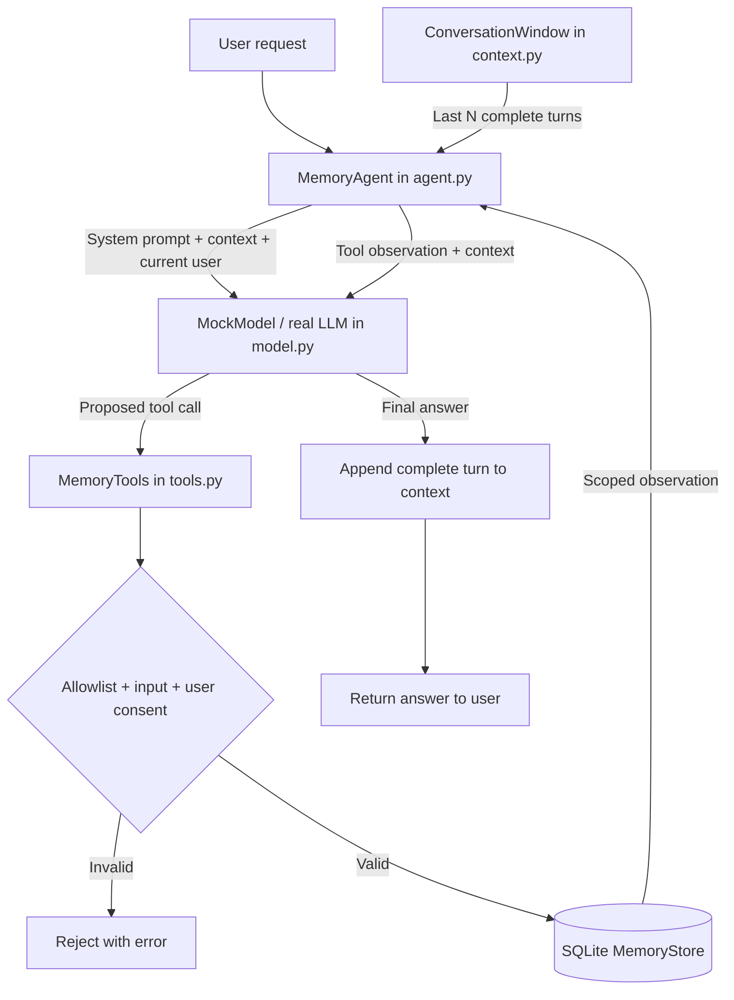

# Lab 5 — Agent Memory: Conversation Context vs Persistent Facts

**Goal:** Build a small, independently runnable agent that remembers information **inside one conversation** (short-term memory) and selectively persists a user-approved fact **across process restarts** (long-term memory). Learn memory retrieval, scope isolation, tool contracts, bounded context, and explicit forgetting.

**Prerequisites:** Labs 0–4 (Agent Loop, tool calls, error handling, execution state, planning). This lab is standalone and imports **no code from other labs**. It uses Python standard-library SQLite and the existing shared root `requirements.txt` for optional real LLM calls.

## 1. What problem does Memory solve?

LLMs do not remember your previous request by themselves across independent API calls. An agent application can deliberately supply some previous conversation messages in the next model request, or retrieve previously saved facts from an external store.

These are **different responsibilities**:

| | Conversation Context (Short-Term) | Long-Term Memory |
| --- | --- | --- |
| Lifetime | While this session object is alive | Across new sessions and Python processes |
| Storage | Python `ConversationWindow` in RAM | SQLite `MemoryStore` on disk |
| Example | "For this chat, the codename is Orion" | "Remember that my preferred programming language is Python" |
| Selection | Last `N` complete user turns | Explicitly saved key/value facts |
| Retrieval | Automatically appended to model messages | Explicit `recall_memory` tool |
| Invalidation | Window eviction or session restart | Explicit `forget_memory` or overwrite |
| Trust boundary | Messages may include untrusted user/tool content | Stored values are untrusted data, not instructions |

**Agent State is not the same as Long-Term Memory.** Lab 3's `AgentState` tracks the lifecycle of one run and checkpoints. Lab 5 persists selected user facts for later runs. This lab does not implement durable conversation replay: starting a new process starts a new short-term conversation.

## 2. Files: separate modules by responsibility

```text
5-agent-memory/
├── agent.py                # MemoryAgent runtime + CLI (entry point)
├── model.py                # Model protocol, MockModel, OpenAI/vLLM adapter
├── context.py              # ConversationWindow: last N complete turns
├── memory.py               # MemoryStore: durable SQLite user-scoped facts
├── tools.py                # save_memory, recall_memory, forget_memory
├── README.md               # This tutorial
├── data/                   # Runtime SQLite files (gitignored)
└── tests/
    ├── test_agent.py       # End-to-end multi-session and budget tests
    ├── test_context.py     # Context window integrity and eviction tests
    ├── test_memory.py      # SQLite persistence and user isolation tests
    └── test_tools.py       # Tool permission and input contracts
```

Only `agent.py` owns the orchestration loop. Models, storage, context policy, and tool validation are **separate modules**, so you can change one concept without rewriting the others.

## 3. Architecture and how a question flows



There is **no automatic dump of the full database into the LLM prompt**. The model must decide to call `recall_memory(key)`; the runtime returns only that fact for the current user scope.

### Responsibility table

| Component | What it does | What it does NOT do |
| --- | --- | --- |
| `ConversationWindow` | Keeps recent user/assistant/tool messages intact | Persist them across restarts |
| `MemoryStore` | Save, read, update, delete scoped facts durably | Infer what is worth remembering |
| `MemoryTools` | Validate tool name, argument shape, explicit write/delete intention | Allow LLM to pick `user_id` |
| `Model` | Propose tool calls and compose text from observations | Directly access SQLite |
| `MemoryAgent` | Compose prompt, execute tool calls, enforce budgets, append final conversation turn | Guarantee all LLM prose is factually correct |

## 4. Example A — Short-term context works only in the active session

Run:

```bash
cd ~/lab/ai-agent-learning
.venv/bin/python 5-agent-memory/agent.py --mock --demo
```

Part of the conversation:

```text
Q: For this chat, my project codename is Orion.
A: Noted for this conversation: Orion.

Q: What is the project codename?
A: The project codename in this chat is Orion.
```

This works because `MemoryAgent.ask()` builds model messages from:

```python
messages = [
    {"role": "system", "content": SYSTEM_PROMPT},
    *self.context.messages(),
    {"role": "user", "content": question},
]
```

The window tracks **complete** user turns, including any assistant tool calls and tool responses. The default is three completed turns:

```python
ConversationWindow(max_turns=3)
```

When a fourth turn finishes, the oldest turn is removed. This is **not** a semantic summary, vector store, or independent memory extraction: it is a bounded recent-message window. In `--demo`, creating a fresh `MemoryAgent` without restoring that window removes the Orion note.

### Why complete-turn trimming matters

A tool call is an assistant message, followed by a correlated tool observation, then typically an assistant final response. Trimming *individual messages* could leave an orphan tool response that breaks the next OpenAI-compatible request. `ConversationWindow` trims **groups of messages that belong to one turn**.

## 5. Example B — Long-term memory survives a new Python process

**Step 1: Explicitly ask the agent to save a preference.**

```bash
cd ~/lab/ai-agent-learning
.venv/bin/python 5-agent-memory/agent.py \
  --mock --user alice \
  --memory-db 5-agent-memory/data/lesson.sqlite3 \
  --ask "Remember that my preferred programming language is Python."
```

Expected flow:

```text
User: Remember that my preferred programming language is Python.
  |
MockModel / LLM: save_memory(key="programming_language", value="Python")
  |
MemoryTools: validated explicit write request and grounded value
  |
MemoryStore: SQLite UPSERT WHERE user_id="alice"
  |
Tool observation: {"ok":true,"key":"programming_language","value":"Python"}
  |
Assistant final: Saved programming_language = Python.
```

The tool's **model-generated arguments do not contain `user_id`**. The runtime creates `MemoryTools(store, user_id="alice")` and attaches that scope itself.

**Canonical key contract:** For this example, the canonical key is `programming_language`. Real models may propose the synonymous `preferred_programming_language` or `programming_language_preference`. `MemoryTools` maps these known aliases to the canonical key for new writes and reads, and supports read-only fallback for older databases that contain an alias. An explicit forget operation also clears these recognized legacy aliases. This is a **small explicit alias table**, not semantic similarity search; unknown keys remain separate facts.

**Step 2: Start a separate Python process and retrieve it.**

```bash
.venv/bin/python 5-agent-memory/agent.py \
  --mock --user alice \
  --memory-db 5-agent-memory/data/lesson.sqlite3 \
  --ask "What programming language do I prefer?"
```

The new agent has no previous in-memory conversation, but it can use:

```text
Model: recall_memory(key="programming_language")
  |
MemoryTools: read only the current user's row
  |
SQLite: SELECT value FROM facts WHERE user_id=? AND key=?
  |
Observation: {"ok":true, "found":true, "value":"Python"}
  |
Assistant: Your saved programming language preference is Python.
```

**Step 3: Prove user isolation.**

```bash
.venv/bin/python 5-agent-memory/agent.py \
  --mock --user bob \
  --memory-db 5-agent-memory/data/lesson.sqlite3 \
  --ask "What programming language do I prefer?"
```

Bob has no saved preference, even though Alice saved one in the same database.

**Important:** `--user` is a **teaching/demo namespace**, not authentication. In a production service the authenticated application layer must choose the user ID; it must never be taken directly from an untrusted client or model.

## 6. Explicit forgetting and updating

Only an explicit request beginning with **forget** authorizes the `forget_memory` tool:

```bash
.venv/bin/python 5-agent-memory/agent.py \
  --mock --user alice \
  --memory-db 5-agent-memory/data/lesson.sqlite3 \
  --ask "Forget my preferred programming language."
```

The tool returns `deleted: true` when a fact was removed, or `false` when none existed. Repeatedly remembering the same `(user_id, key)` **overwrites** the previous value via an SQLite UPSERT.

No fact is written merely because the user says something conversationally. The storage policy requires a request starting with `remember`. The runtime also verifies that a proposed memory value occurs in the current user request, avoiding at least simple invented-value writes.

## 7. Tool-calling contract and safety controls

`model.py` defines:

```python
@dataclass(frozen=True)
class ToolCall:
    id: str
    name: str
    arguments: str

@dataclass(frozen=True)
class ModelTurn:
    content: str | None = None
    tool_calls: tuple[ToolCall, ...] = ()
```

The three tools in `tools.py` are:

| Tool | Arguments | Allowed when |
| --- | --- | --- |
| `save_memory` | `key`, `value` | Current user message explicitly begins with "remember" |
| `recall_memory` | `key` | Retrieval is requested; no write |
| `forget_memory` | `key` | Current user message explicitly begins with "forget" |

Tool validation rejects unsupported tools, invalid JSON, unexpected arguments, invalid keys, ungrounded values and unauthorized writes/deletes. The runtime validates call IDs, rejects multi-tool responses, and enforces a small execution budget:

```python
Limits(
    max_model_calls=4,
    max_tool_calls=2,
    max_user_chars=1000,
)
```

The default window keeps three complete turns. These are teaching budgets; they do not enforce a token-count ceiling, provider cost cap, or maximum wall-clock execution time.

The `MemoryStore` uses parameterized SQL and creates new database files with owner-only `0600` permissions on POSIX. The store does **not** encrypt values at rest. Avoid placing secrets, passwords, tokens or sensitive personal data in the example database.

## 8. Running with a real LLM

The lab uses the **shared root** `.env` (no per-lab config):

```dotenv
LLM_BASE_URL=https://api.openai.com/v1
LLM_MODEL=<your-model>
LLM_API_KEY=<your-key>
LLM_TIMEOUT=30
```

For an OpenAI-compatible vLLM endpoint, change `LLM_BASE_URL` and `LLM_MODEL` as needed. Never commit the real `.env`.

```bash
cd ~/lab/ai-agent-learning

# A real LLM decides when to call save_memory
.venv/bin/python 5-agent-memory/agent.py \
  --live --user alice \
  --ask "Remember that my preferred programming language is Python."

# Separate invocation: model decides to call recall_memory
.venv/bin/python 5-agent-memory/agent.py \
  --live --user alice \
  --ask "What programming language do I prefer?"
```

Both invocations use the default SQLite database in `5-agent-memory/data/`. The model must support Chat Completions **tool calling**. Unlike `MockModel`, its behavior may vary. The runtime rejects attempts to claim a write/delete occurred without actually using its tool, but there is no universal semantic memory verifier.

`--mock` forces offline mode even when `LIVE_MODE=1` is set. If `LIVE_MODE=1` is exported and you omit `--mock`, the default is live mode.

### Why not automatically save every conversation?

Automatic extraction has privacy, relevance, versioning and consent implications. This lab is **opt-in by design**. No embedding model, external vector database or memory extraction LLM is needed to understand the basic lifecycle.

## 9. Inspecting the SQLite facts and traces

To understand memory persistence manually without a new dependency:

```bash
cd ~/lab/ai-agent-learning
.venv/bin/python - <<'PY'
import sys
from pathlib import Path
sys.path.insert(0, "5-agent-memory")
from memory import MemoryStore

store = MemoryStore(Path("5-agent-memory/data/lesson.sqlite3"))
print(store.get("alice", "programming_language"))
print(store.get("bob", "programming_language"))
PY
```

To see tool events and recent context:

```bash
.venv/bin/python - <<'PY'
import sys
from pathlib import Path
sys.path.insert(0, "5-agent-memory")
from agent import MemoryAgent
from memory import MemoryStore
from model import MockModel

agent = MemoryAgent(
    MockModel(),
    MemoryStore(Path("5-agent-memory/data/debug.sqlite3")),
    "demo",
)
result = agent.ask("Remember that my preferred programming language is Python.")
print("EVENTS:", result.events)
print("CONTEXT:", agent.context.messages())
PY
```

`TurnResult` contains `status`, `answer`, `model_calls`, `tool_calls`, and `events`. Logs are intentionally local to the returned result; unlike Lab 3, they are not durable event-sourcing or checkpoint infrastructure.

## 10. Tests

```bash
cd ~/lab/ai-agent-learning
.venv/bin/python -m unittest discover -s 5-agent-memory/tests -v
```

The tests cover new process persistence, user isolation, SQLite validation, values treated as data, explicit write/forget consent, bounded conversation windows, complete tool-call history, invalid tool responses, model failures, and execution limits.

## 11. Learning exercises

1. **Short-term eviction:** Run `ConversationWindow(max_turns=1)`, teach the agent a temporary codename, then add a different turn. What does the agent remember afterward?
2. **Durability:** Save one preference from one Python process, close it, and retrieve it from another. Compare the new `MemoryAgent` context and the SQLite `MemoryStore`.
3. **Isolation:** Use `--user alice` and `--user bob` with the same database file. Why does the application choose the user scope rather than the LLM?
4. **Update:** Save Python and then Go under `programming_language`. What does the next retrieval return?
5. **Forget:** Delete a preference and verify a new process cannot retrieve it.
6. **Custom key:** In `MockModel`, teach one new explicit preference type, such as `preferred_editor`. What remains reusable in `MemoryStore` and `MemoryTools`?
7. **Next design exercise:** Define a rule that distinguishes truly durable user preferences from task-specific observations before expanding to automatic extraction.

## 12. Limitations and future direction

This is **not** an autonomous personal-memory system: the offline mock supports a few deliberately narrow English intents; `MemoryStore` is key/value SQLite, not vector search; the short-term window is not summarized and has no token-budget estimator; there is no TTL, memory provenance, confidence scoring, semantic deduplication, encryption, authentication, audit retention or cross-process conversation replay. Only explicit remember/forget requests are allowed to change long-term facts, and a real model can still generate wrong keys or answers.

The user-scoped namespace is for learning; production access must be authenticated and authorized server-side. Stored fact contents must continue to be treated as untrusted **data**, never instructions. Use this module as the foundation for a later retrieval/evaluation and memory-policy lesson.

### Live smoke-test finding

In a real OpenAI-compatible model run, the LLM initially chose `preferred_programming_language` on save, while later retrieval used `programming_language`. Both tool calls were valid, but inconsistent keys led to a memory miss. The alias-normalization contract in `tools.py` resolved this; the subsequent real-model read returned the saved Python preference. This is an example of why **stable identifiers and tool contracts matter beyond prompt instructions**.

**Core takeaway:** `ConversationWindow` helps the model follow an ongoing dialog. `MemoryStore` persists selected facts between sessions. `MemoryTools` controls what the model can store, retrieve or forget. `MemoryAgent` coordinates all three without confusing session context with long-term memory.