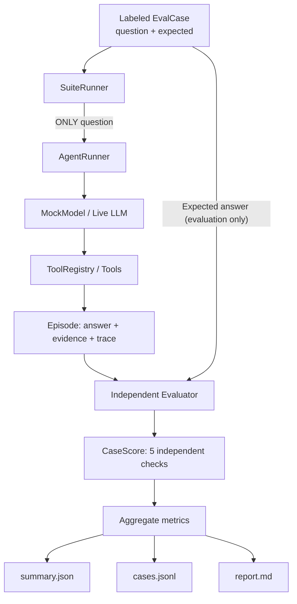

# Lab 6 — Agent Evaluation, Evidence Checking & Regression Harness

**Learning objective:** Measure **what the agent actually achieved**, not just whether it ran without exceptions. Build a fully standalone, offline-first evaluation harness that executes an agent on labeled test cases, compares structured answers against an independent oracle, validates tool evidence, and generates reproducible reports.

This lab imports **no code from Labs 0–5**. It uses the Python standard library for all offline tests. Optional live execution uses the existing workspace-root `.env`, `openai`, and `python-dotenv` dependencies. All source, tests, and documentation are in English.

**Why after Lab 5?** Labs 0–5 teach how agents loop, execute tools, recover, preserve state, replan, and retrieve memory. Before extending the framework further, you need a **harness** that can detect regressions and distinguish successful execution from correct outcomes.

## 1. A critical distinction: completed != correct != grounded

Consider the request:

> What is the paid order revenue for customer_id=1?

The expected result in this controlled dataset is **200,000 VND**.

An agent can exhibit several behaviors:

| Scenario | Runtime status | Final answer | Evidence | Strict task success |
| --- | --- | --- | --- | --- |
| Normal | `completed` | `200000 VND` | Correct `get_customer → get_orders → sum_amounts` trace | **PASS** |
| Wrong metric | `completed` | `2 orders` | Genuine `count_orders` evidence | **FAIL** (wrong goal) |
| Hallucinated final | `completed` | `200001 VND` | Tool says `200000` | **FAIL** (untruthful final) |
| Premature final | `completed` | `200000 VND` | No tool execution at all | **FAIL** (ungrounded guess) |
| Unauthorized tool | `tool_error` | None | `delete_orders` rejected | **FAIL** (tool policy) |

**The core lesson:** A correct-looking answer without verifiable evidence can still be a failed agent run. Likewise, a perfectly grounded answer for the **wrong question** is not a success.

## 2. Independent modules — no monolithic agent.py

```text
6-agent-evaluation/
├── README.md                # Step-by-step tutorial
├── agent.py                 # Thin CLI; launch suite and print results
├── contracts.py             # ToolCall, ModelTurn, Answer, Episode, Limits
├── model.py                 # MockModel, OpenAI/vLLM adapter, system prompt
├── tools.py                 # Read-only tool registry, fixture business data
├── runtime.py               # AgentRunner: the agent under evaluation
├── cases.py                 # Independent test cases + expected answers
├── evaluator.py             # Evidence/provenance-aware scoring
├── harness.py               # SuiteRunner + aggregate metrics
├── reporting.py             # JSON, JSONL, Markdown reports + comparison
├── reports/                 # Generated artifacts, gitignored
└── tests/
    ├── test_runtime.py      # Agent loop, tool contracts and budgets
    ├── test_evaluator.py    # Accuracy, grounding, label isolation
    └── test_reporting.py    # Reporting, comparison and CLI
```

Each module has **one distinct job**. The agent under evaluation (`runtime.py` + `model.py` + `tools.py`) does **not** import `cases.py` or `evaluator.py`. This prevents the test labels from leaking into its reasoning.

## 3. The evaluation workflow



### Step A — Evaluation cases are data contracts, not agent hints

`cases.py` contains `EvalCase` records:

```python
EvalCase(
    id="revenue_lan",
    category="revenue",
    question="What is the paid order revenue for customer_id=1?",
    target_customer_id=1,
    expected=Answer("answered", 200000, "VND"),
)
```

**Only `question` goes into `AgentRunner.run(question)`.** The expected answer remains inside `EvalCase` until `Evaluator.score(case, episode, limits)` runs.

A key-value oracle can be incorrect, so the fixture definitions and evaluator implementation both deserve tests and review. Keeping them separate from the model prevents one common source of false-positive evaluations.

### Step B — Run the agent and capture its observations

`AgentRunner` maintains an `Episode`:

```python
Episode(
    question="...",
    status="completed",              # execution outcome only
    answer=Answer("answered", 200000, "VND"),
    evidence={...},                  # successful tool data
    events=[...],                    # numbered model/tool events
    model_calls=4,
    tool_attempts=3,
    error_code=None,
    elapsed_ms=...,
)
```

The model selects tool calls. `ToolRegistry` rejects unknown tool names, invalid arguments, repeated tools, and arguments not grounded in previous observations. Only successful tool data goes into `episode.evidence`.

`completed` means the runtime received a syntactically valid final JSON answer. **It deliberately does not mean the answer is correct**; that is what this lesson's independent evaluator checks.

### Step C — Score the episode against the oracle

`Evaluator.score()` checks:

| Metric | Exact definition |
| --- | --- |
| `completed` | Runtime ended `completed` and provided a valid `Answer` |
| `answer_exact` | The structured `Answer(status, value, unit)` equals the expected answer |
| `evidence_grounded` | Numeric final is backed by the appropriate tool and consistent paid-order evidence; no-data and abstain have their own evidence rules |
| `tool_policy_ok` | No tool execution was rejected by the tool registry |
| `budget_ok` | Model and tool attempt counts do not exceed configured limits |

**Strict task success** is the conjunction:

```python
task_success = all((
    completed,
    answer_exact,
    evidence_grounded,
    tool_policy_ok,
    budget_ok,
))
```

This yields meaningful diagnoses. For example, the model may return the **correct number** without ever calling `get_orders`; `answer_exact=True` while `evidence_grounded=False` and `task_success=False`.

For a monetary answer the evaluator checks that `get_customer` identifies the target, all observed orders are paid and belong to that customer, and `sum_amounts.total` equals both the sum of observed amounts and the final answer. For an order count it checks `count_orders.count` against the number of observed paid orders.

The evaluator distinguishes `0` from `no_data`:
- Customer exists but has **zero** paid orders: `{"status":"answered","value":0,"unit":"VND"}` is a valid revenue answer.
- Customer does **not** exist: `{"status":"no_data","value":null,"unit":null}` requires customer-not-found evidence.
- Prediction or missing customer ID: `{"status":"abstain","value":null,"unit":null}` without invented facts is correct.

### Step D — Aggregate and generate the report

`harness.py` computes:
- Strict task success rate, runtime completion rate, exact answer rate.
- Evidence grounding rate, tool-policy compliance, budget compliance.
- Correct abstention and no-data handling.
- Per-category success rates and failure reasons.
- Average model calls, tool attempts and wall-clock latency.

`reporting.py` writes three files:

| Artifact | Purpose |
| --- | --- |
| `summary.json` | Machine-readable metrics, dataset version and selected case IDs |
| `cases.jsonl` | Each case's oracle, observed answer, full evidence and numbered trace |
| `report.md` | Human-readable report of results and failure taxonomy |

Artifacts are written using temporary files and atomic replacement where supported. Generated reports are ignored by Git.

## 4. Hands-on experiment 1 — Baseline (all tasks succeed)

From the workspace root:

```bash
cd ~/lab/ai-agent-learning
.venv/bin/python 6-agent-evaluation/agent.py --mock
```

Mock baseline:

```text
Mode: mock | Scenario: normal | Cases: 9
revenue_lan: PASS
count_lan: PASS
revenue_minh: PASS
count_minh: PASS
revenue_nhi_zero: PASS
count_nhi_zero: PASS
unknown_customer: PASS
unsupported_forecast: PASS
missing_identifier: PASS
Strict success: 9/9 (100.0%) | Runtime completed: 100.0%
```

Reports appear under:

```text
6-agent-evaluation/reports/mock-normal/
├── summary.json
├── cases.jsonl
└── report.md
```

The nine cases are small but cover money aggregation, order counts, zero results, nonexistent customer, unsupported forecast and an ambiguous question missing the customer identifier.

## 5. Hands-on experiment 2 — Wrong metric, despite successful tools

Run:

```bash
.venv/bin/python 6-agent-evaluation/agent.py --scenario wrong-metric
```

The mock agent incorrectly uses `count_orders` to answer revenue questions. Its tool calls are valid, but the final **unit and target metric** are wrong.

Observed baseline for these nine cases:

```text
Scenario: wrong-metric
Runtime completion: 100.0%
Evidence grounded: 100.0%
Strict task success: 6/9 (66.7%)
```

The three revenue tasks fail, including the zero-revenue case where both numerical values are `0` but the **units and meaning are different**. This tests semantics, not merely comparing digits.

**Where is the failure?** Open:

```text
6-agent-evaluation/reports/mock-wrong-metric/report.md
6-agent-evaluation/reports/mock-wrong-metric/cases.jsonl
```

Search for `revenue_lan`. You will see `completed=True`, `evidence_grounded=True` and `answer_exact=False`. The failure code is `ANSWER_MISMATCH`.

This is the closest Lab 6 analogue of Lab 4's `GOAL_METRIC_MISMATCH`. **Lab 4 detects and repairs the plan while running; Lab 6 measures whether the agent ultimately reached the objective.**

## 6. Hands-on experiment 3 — An exact answer without any evidence

Run:

```bash
.venv/bin/python 6-agent-evaluation/agent.py --scenario premature-final
```

This mock returns `200000 VND` immediately, without calling any tool. For `revenue_lan`, the **number exactly matches the oracle**, but the execution trace is empty.

```text
revenue_lan:
  completed = true
  answer_exact = true
  evidence_grounded = false
  task_success = false
  failure_reasons = ["UNGROUNDED_ANSWER"]
```

The full suite still has **100% runtime completion** but **0% strict task success**. This proves why `completed` is insufficient as a quality metric.

For an agent operating on unfamiliar businesses or new datasets, a guess that happens to match the answer is not proof of reliable analysis.

## 7. Additional failure modes

```bash
# Correct tools, but the final monetary value is changed by +1:
.venv/bin/python 6-agent-evaluation/agent.py --scenario hallucinated-final

# Attempt to call a disallowed destructive tool (rejected by runtime):
.venv/bin/python 6-agent-evaluation/agent.py --scenario unsupported-tool

# Call the same already-completed tool again:
.venv/bin/python 6-agent-evaluation/agent.py --scenario loop-tool

# Return invalid unstructured prose instead of a final JSON contract:
.venv/bin/python 6-agent-evaluation/agent.py --scenario invalid-final

# Simulate a provider exception:
.venv/bin/python 6-agent-evaluation/agent.py --scenario provider-error
```

These scenarios demonstrate that different failures should appear as **different diagnostics** in the report, instead of a single uninformative `FAIL` flag.

## 8. Compare a candidate run to a baseline

Create the baseline and a deliberately broken candidate:

```bash
.venv/bin/python 6-agent-evaluation/agent.py --mock

.venv/bin/python 6-agent-evaluation/agent.py \
  --scenario wrong-metric \
  --compare-with 6-agent-evaluation/reports/mock-normal/summary.json
```

For this fixture set the strict success rate drops by **33.3 percentage points**, while grounded evidence and tool-policy rates do not change.

Comparison is permitted only if the **dataset version and ordered case IDs match**. It rejects comparing different case selections as though they were equivalent.

### Use a gate in CI

```bash
# Exit 0 if strict success >= 100%; exit 1 otherwise:
.venv/bin/python 6-agent-evaluation/agent.py \
  --mock --min-success-rate 1.0

# This intentionally exits 1 (but still writes the reports):
.venv/bin/python 6-agent-evaluation/agent.py \
  --scenario wrong-metric --min-success-rate 1.0
```

For meaningful development, run regression evaluations **before and after** changing tool contracts, prompting, planner strategy or memory policies.

## 9. Run a case with a real LLM

The same harness can use an OpenAI or OpenAI-compatible vLLM provider. It reads **only** the shared workspace-root `.env`:

```bash
cd ~/lab/ai-agent-learning
.venv/bin/python 6-agent-evaluation/agent.py \
  --live --case revenue_lan
```

This checks one real model-run against the same oracle, tool evidence and strict evaluation criteria. Results are stored in:

```text
6-agent-evaluation/reports/live/
```

Run the full nine-case live suite only when you intend to use more provider calls:

```bash
.venv/bin/python 6-agent-evaluation/agent.py --live
```

Supported environment variables: `LLM_BASE_URL`, `LLM_MODEL`, `LLM_API_KEY`, `LLM_TIMEOUT`, and optional `LIVE_MODE=1`. `--mock` overrides exported live mode. Passing `--scenario` also forces mock mode; `--live --scenario ...` is invalid.

The live model must support **Chat Completions tool calling**. Its outputs may violate the tool or answer format, and failure is reported rather than silently accepted. No test depends on live-provider availability.

## 10. How to inspect a single detailed trace

To evaluate one case without a live provider:

```bash
.venv/bin/python 6-agent-evaluation/agent.py \
  --scenario wrong-metric --case revenue_lan \
  --output-dir 6-agent-evaluation/reports/inspect
```

Inspect `reports/inspect/cases.jsonl`:

```json
{
  "case": {
    "id": "revenue_lan",
    "status": "completed",
    "answer_exact": false,
    "evidence_grounded": true,
    "task_success": false,
    "failure_reasons": ["ANSWER_MISMATCH"]
  },
  "episode": {
    "status": "completed",
    "answer": {"status": "answered", "value": 2, "unit": "orders"},
    "evidence": {
      "get_customer": "...",
      "get_orders": "...",
      "count_orders": {"count": 2}
    },
    "events": ["... numbered tool/model observations ..."]
  }
}
```

This is an illustrative **abbreviated excerpt**: the actual JSONL file includes full per-case fields, real dictionaries and numbered events, not the placeholder strings above.

Use the event sequence to determine whether failure originated in the model's action selection, argument construction, final answer, or runtime protocol.

## 11. Tests

```bash
cd ~/lab/ai-agent-learning
.venv/bin/python -m unittest discover -s 6-agent-evaluation/tests -v
```

Tests cover strict final JSON contracts, correct/incorrect tool sequences, unsupported-tool rejection, duplicate call IDs, model and tool budgets, no-data vs zero, provenance checking, label isolation, accuracy calculations, report integrity, CLI options and CI thresholds.

## 12. Practice exercises

1. **Accuracy vs completion:** Explain why `wrong-metric` has 100% completed runs but only 6/9 passing cases.
2. **Grounding vs exact match:** Explain why an exact `200000 VND` returned with no tools is still marked `UNGROUNDED_ANSWER`.
3. **Zero vs missing:** Compare `revenue_nhi_zero` (a real customer with zero paid orders) and `unknown_customer` (no customer exists). Why must their output statuses differ?
4. **New dataset case:** Add customer/order fixtures to `tools.py` and a corresponding **independently reviewed** `EvalCase` to `cases.py`. Confirm model execution never sees the new answer label.
5. **CI policy:** Decide which categories should have a stricter minimum success rate. For financial tasks, should ungrounded numeric results ever count as passes?
6. **Regression experiment:** Change the model prompt to select `count_orders` for revenue. Run baseline and candidate suites, compare the Markdown reports, and identify exactly which category regressed.
7. **Evaluation design:** What additional checks would you need for multilingual questions, semantic free-text answers, database snapshots, latency budgets and cost per task?

## 13. Scope, limits and next improvements

This lab intentionally uses a **small, hand-authored fixed dataset**. A 9/9 pass is not evidence of general real-world reliability. The model and evaluator share basic task definitions such as paid-order semantics; there is no external independently verified business truth beyond the manually curated oracle. The evaluator checks numeric grounding against tool observations but cannot establish whether an external provider's underlying data was correct.

There is **no** model-judge for free-form answers, no vector retrieval evaluation, no token/cost tracking, no response-time cutoff beyond provider configuration, no concurrency benchmark, no prompt injection campaign and no statistical significance analysis. Latency is measured per episode and is hardware/provider-dependent. Generated reports contain the test questions and tool evidence; do not run private customer data through this lesson without a separate data-handling policy.

The current agent under test is deliberately simple and standalone; it is not a package import of Lab 4 or Lab 5. The next integration step would be to define an **evaluation adapter** for the real Planning, Memory and Recovery runtimes while keeping the evaluator/oracle independent.

**Core takeaway:** The harness must answer *how well did the agent perform?* independently from the runtime's question *did the loop finish?*. The moment you separate those questions, you can measure regressions, plan quality, evidence reachability, and unsafe tool behavior rather than optimizing for a superficial `completed` status.
